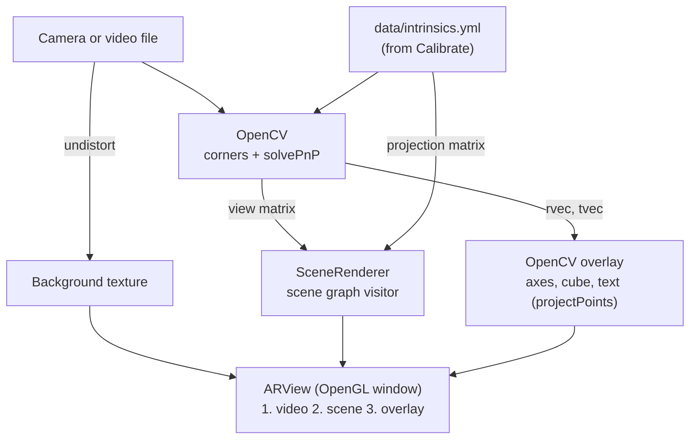

# SceneGraph AR

**English** | [简体中文](README.zh-CN.md)

Camera calibration and marker-based augmented reality with OpenCV, OpenGL and C++. A printed
9×6 checkerboard is the target: OpenCV calibrates the camera from a handful of views and
estimates the board's pose in every video frame, and OpenGL renders a lit, depth-tested 3D
scene graph (the Hogwarts castle from SceneGraph Renderer) standing on the board, through a
projection built from the camera calibration so that it lines up with the video. A third
program detects Harris corners for experimenting with feature points.


*Left: `Calibrate` finds and orders the 54 inner corners. Right: `AugmentedReality` renders the
Hogwarts scene graph with OpenGL, with the board axes and the live pose drawn by OpenCV on top.
Both frames come from a synthetic checkerboard video used for testing; press `S` in the
programs to save your own.*

**Contents:** [Highlights](#highlights) ·
[Tech stack](#tech-stack) ·
[Architecture](#architecture) ·
[How it works](#how-it-works) ·
[Project structure](#project-structure) ·
[Build and run](#build-and-run)

## Highlights

- **Camera calibration**: subpixel checkerboard corners, user-selected views, and
  `cv::calibrateCamera` for the camera matrix and five distortion coefficients. The result
  is written to a YAML file that the AR program reads.
- **Real-time pose estimation**: `cv::solvePnP` on the 54 corner correspondences every
  frame, with the rotation and translation shown live on the video.
- **Virtual objects**: 3D axes on the board origin and a multi-colored wireframe cube floating
  above the board, projected with `cv::projectPoints` and toggled with a key.
- **OpenCV + OpenGL**: the calibrated intrinsics become an OpenGL projection matrix and the
  `solvePnP` pose becomes the view matrix, so OpenGL and `projectPoints` agree to within
  0.001 px. The video is undistorted and drawn as a background texture, the scene graph is
  rendered on top with a depth buffer and Blinn-Phong lighting, and OpenCV's drawings are
  composited above it as a transparent overlay.
- **Scene graph rendering**: the text scene format from SceneGraph Renderer (meshes,
  materials, transforms, subtree copies) is loaded into a scene graph and drawn every frame by
  a visitor with a matrix stack; each mesh is uploaded to the GPU once.
- **Harris corners**: the full detector pipeline (response, threshold relative to the
  strongest response, non-maxima suppression, top N) with the threshold and N adjustable
  while the video runs.
- **Video files as input**: every program takes a camera index or a video file, so results
  can be reproduced without a camera.
- **Cross-platform build**: CMake presets and one-click run scripts. Verified on Windows 11
  (Visual Studio 2026, OpenCV 4.13) and Ubuntu 22.04 (GCC 11, OpenCV 4.14, under WSL2).


*Left: the virtual object, a 2×2×2 cube floating one square above the board, with the
board axes (X red, Y green, Z blue). Right: `HarrisFeatures` with the default threshold
(5% of the strongest response): every detection is a corner of the board or the paper.
Synthetic test frames.*

## Tech stack

| Area | Technology |
|---|---|
| Language | C++17 (STL only; no game engine) |
| Computer vision | [OpenCV](https://opencv.org/) 4: `calib3d` (calibration, PnP, projection, undistortion), `imgproc`, `videoio`, `highgui` |
| Graphics | OpenGL 3.3 core profile, GLSL 330 (forward-compatible context, so it also runs on macOS) |
| Window and input | [GLFW](https://www.glfw.org/) 3.4 (AR program); OpenCV HighGUI (calibration and Harris programs) |
| Math | [GLM](https://github.com/g-truc/glm) 1.0 |
| OpenGL loader | [glad](https://glad.dav1d.de/) (generated, vendored) |
| Build | CMake ≥ 3.21 with `CMakePresets.json`; GLFW and GLM via `FetchContent` (pinned versions) |
| Asset formats | Wavefront OBJ meshes, a custom text scene format, OpenCV YAML for the calibration |
| Platforms | Windows (Visual Studio + official OpenCV package), Linux (GCC / Clang, X11 / Wayland), macOS (Apple Clang + Homebrew; not yet verified on hardware) |

## Architecture

The project builds three programs. They share the OpenCV library `sgar_common`; the AR
program also uses the OpenGL library `sgar_render`.

| Program | Tasks | What it does |
|---|---|---|
| [`Calibrate`](src/apps/Calibrate.cpp) | 1–3 | Detects the board, saves views, calibrates, writes `data/intrinsics.yml` |
| [`AugmentedReality`](src/apps/AugmentedReality.cpp) | 4–6, extension | Reads the calibration, estimates the board pose, draws axes and the wireframe object, renders the scene with OpenGL |
| [`HarrisFeatures`](src/apps/HarrisFeatures.cpp) | 7 | Detects and draws Harris corners with adjustable settings |

Task numbers follow the seven tasks of the course assignment: 1 detecting the target's
corners, 2 selecting calibration views, 3 calibrating the camera, 4 estimating the camera
pose, 5 projecting 3D axes, 6 drawing a virtual object, 7 detecting robust features.



| Module | Responsibility |
|---|---|
| [`Calibration`](src/Calibration.h) | Board size, 3D world points, corner detection, the `calibrateCamera` wrapper, reading and writing the intrinsics |
| [`AppUtils`](src/AppUtils.h) | Opening a camera or video file, the working directory, the `data/` folder, the on-screen help bar |
| [`ARView`](src/ARView.h) | GLFW window and OpenGL context, the three-layer frame composition, keyboard input, screenshots |
| [`SceneRenderer`](src/SceneRenderer.h) | Loads the scene graph, uploads its meshes, draws it for a camera and pose with lighting |
| [`gl/`](src/gl) | `CameraMatrices` (OpenCV calibration and pose → OpenGL matrices), `ShaderProgram`, `Mesh`, `Texture` |
| [`sgraph/`](src/sgraph) | Scene graph nodes, the scene file importer, and `GLScenegraphRenderer`, the visitor that draws |
| [`util/`](src/util) | Polygon meshes, the OBJ importer, materials |

**One frame of `AugmentedReality`** ([main loop](src/apps/AugmentedReality.cpp#L205)):

1. Find the board's inner corners in the raw frame; if found, `solvePnP` gives the board's
   rotation `rvec` and translation `tvec` relative to the camera.
2. Undistort the frame, and draw the enabled 2D overlays (cube, axes, pose, help bar) on a
   transparent image with `projectPoints`.
3. [`ARView::render`](src/ARView.cpp#L156) draws the video as a background texture, the scene
   graph with depth testing, then the overlay with alpha blending, and swaps buffers.
4. Handle the keys collected by GLFW.

## How it works

### The target and its coordinate system

The board has 9 × 6 inner corners. World units are checkerboard squares, and the world is
attached to the board ([`buildPointSet`](src/Calibration.cpp#L18)): corner `(col, row)` is
the 3D point `(col, -row, 0)`. X points right along the first row, Y points up the board, and
Z = X × Y points out of the board toward the camera, so anything with Z > 0 floats above the
board. The same 54 points are used for every view, because the camera moves and the world
does not.

### Calibration (Tasks 1–3)

- **Corners** ([`detectCorners`](src/Calibration.cpp#L34)): `findChessboardCorners` with
  adaptive thresholding, image normalization and the fast check (frames without a board are
  rejected quickly), then `cornerSubPix` refines each corner in an 11 × 11 window to
  0.001 px. The corners come back in row-major order, generally starting at the upper left,
  matching the order of the world points. The window shows the corner count and the
  position of the first corner, which makes a flipped ordering easy to spot.
- **Views**: `S` stores the corners of the last successful detection together with a copy
  of the world points, and saves the frame with the corners drawn to `data/calib_NNN.png`.
  Frames where the board is not found are not saved.
- **Solving** ([`runCalibration`](src/Calibration.cpp#L65)): with at least 5 views, `C`
  runs `cv::calibrateCamera` starting from

  ```
        [ 1  0  w/2 ]
  K0 =  [ 0  1  h/2 ]
        [ 0  0   1  ]
  ```

  and estimates the focal lengths, the principal point and the distortion coefficients
  (k1, k2, p1, p2, k3). The camera matrix and the distortion coefficients before and after,
  and the reprojection error, are printed; under one pixel means the calibration is good. The
  result, with the image size and the error, goes to `data/intrinsics.yml`.

### Pose and projection (Tasks 4–6)

- **Pose**: `solvePnP` finds the rotation and translation that map the board's world
  points to the detected corners. `tvec` is the position of the board origin in camera
  coordinates, measured in squares, so its Z component is the distance to the board, and
  moving the camera to the right makes X decrease. `rvec` is the rotation as a Rodrigues
  vector.
- **Axes** ([`drawAxes`](src/apps/AugmentedReality.cpp#L82)): the origin and the ends of
  2-square-long X, Y and Z axes are projected with `projectPoints`.
- **Virtual object** ([`drawVirtualObject`](src/apps/AugmentedReality.cpp#L98)): the 8
  vertices of a cube spanning Z = 1 to 3 are projected with `projectPoints` (rotation,
  translation, camera matrix and distortion), and the 12 edges are drawn in three colors.

### Rendering the scene with OpenGL (extension)

**Matching the camera.** The undistorted video and OpenGL must use the same pinhole camera.
[`projectionFromIntrinsics`](src/gl/CameraMatrices.cpp#L15) turns K and the image size
w × h into an OpenGL projection, with n and f the near and far planes:

```
      [ 2fx/w    0       1 - 2(cx+0.5)/w      0         ]
P  =  [ 0        2fy/h   2(cy+0.5)/h - 1      0         ]
      [ 0        0       -(f+n)/(f-n)         -2fn/(f-n) ]
      [ 0        0       -1                   0         ]
```

[`viewFromPose`](src/gl/CameraMatrices.cpp#L42) builds `[R | t]` from `rvec` and `tvec` and
flips its Y and Z rows, because OpenCV's camera looks down +Z with Y pointing down the image
while OpenGL's looks down -Z with Y up. The +0.5 terms account for OpenCV placing pixel
centers on integer coordinates. A point rendered through P · V lands within 0.001 px of where
`projectPoints` puts it.

**Distortion.** OpenGL can only draw a pinhole projection, so the frame is undistorted with
`initUndistortRectifyMap` / `remap` (maps computed once) using the same K. The pose is still
estimated from the raw corners with the distortion coefficients, and the overlay is projected
without distortion, so all three layers agree.

**Three layers** ([`ARView::render`](src/ARView.cpp#L156)), drawn into a viewport with the
video's aspect ratio:

1. The undistorted frame, uploaded to a texture each frame and drawn as a quad that fills
   the viewport, without writing depth.
2. The scene graph, with depth testing.
3. The OpenCV overlay: an RGBA image cleared to transparent, on which the axes, the cube and
   the text are drawn with antialiasing. Antialiased drawing on a transparent image produces
   premultiplied alpha, so it is blended with `glBlendFunc(GL_ONE, GL_ONE_MINUS_SRC_ALPHA)`.

**The scene graph.** The model is the Hogwarts castle described in the scene language of
SceneGraph Renderer ([`hogwarts.txt`](assets/scenegraphmodels/hogwarts.txt)): 17 leaves of
box, cylinder and cone meshes, 20 subtree copies, and translate and scale nodes.

```
instance cylinder models/cylinder.obj

material tower-body-mat
ambient 1 0 0
end-material

translate translate-tower-1 translate-tower-1 5 25 -5
add-child translate-tower-1 root
...
leaf body-1 body-1 instanceof cylinder
assign-material body-1 tower-body-mat
copy tower-2 tower-1                  # deep-copy a whole subtree
```

- **Loading** ([`SceneRenderer::load`](src/SceneRenderer.cpp#L28)):
  [`ScenegraphImporter`](src/sgraph/ScenegraphImporter.h#L54) builds the graph, and each OBJ
  mesh (positions and normals) is uploaded once into a vertex array object.
- **Drawing** ([`SceneRenderer::draw`](src/SceneRenderer.cpp#L54)): the
  [`GLScenegraphRenderer`](src/sgraph/GLScenegraphRenderer.h#L57) visitor walks the graph with
  a matrix stack that starts at `V · M`, where the placement
  ([`scenePlacement`](src/apps/AugmentedReality.cpp#L53))

  ```
  M = scale(0.1) · translate(0, -60, 0) · rotateX(90°)
  ```

  stands the model up (its Y axis becomes the board's Z axis), moves it onto the board, and
  makes 10 scene units one square. Every leaf draws its mesh with the current modelview
  matrix, its normal matrix and its material color: about 16,600 triangles per frame. On the
  test PC a whole 1280 × 720 frame (both texture uploads, the castle and the overlay) renders
  in about 1.7 ms.
- **Lighting** ([`scene.frag`](assets/shaders/scene.frag)): Blinn-Phong with one directional
  light fixed to the board (from above, in front and to the left), so the shading stays
  consistent as the camera moves around the board.

### Harris corners (Task 7)

[`detectAndDrawHarris`](src/apps/HarrisFeatures.cpp#L54) follows the textbook pipeline:

```
A = Σ_window [ Ix²   IxIy ]        H = det(A) - k · trace(A)²,  k = 0.04
             [ IxIy  Iy²  ]
```

1. `cornerHarris` computes H with a 2 × 2 window and 3 × 3 Sobel gradients. H is large and
   positive at corners, negative along edges and close to 0 in flat regions.
2. Pixels with H below the threshold times the strongest response (0.05 by default) are
   dropped. The threshold is applied to the raw H: rescaling H to [0, 255] first would map
   the most negative edge response to 0 and let flat regions pass.
3. Non-maxima suppression keeps only pixels equal to the maximum of their 3 × 3
   neighborhood (the `dilate`d response), so each corner gives one point.
4. The candidates are sorted by H and the N strongest (500 by default) are drawn.

On the checkerboard, the strongest responses are the inner corners, which is why corner
features like these can replace the checkerboard as an AR target: if the same points can be
found and matched in every frame, their known 3D positions give the pose through `solvePnP`.

## Project structure

```
.
├── CMakeLists.txt            three programs, the OpenCV and OpenGL libraries, asset and DLL copy
├── CMakePresets.json         presets: msvc (Windows), default (macOS / Linux)
├── run.bat                   one-click build + run (Windows)
├── run.sh / run.command      one-click build + run (macOS / Linux; .command is for Finder)
├── cmake/
│   └── Dependencies.cmake    OpenCV lookup, GLFW and GLM versions, glad
├── src/
│   ├── apps/
│   │   ├── Calibrate.cpp         Tasks 1–3
│   │   ├── AugmentedReality.cpp  Tasks 4–6 and the OpenGL scene graph extension
│   │   └── HarrisFeatures.cpp    Task 7
│   ├── Calibration.*         board definition, corners, calibration, intrinsics file
│   ├── AppUtils.*            video input, working directory, data folder, help bar
│   ├── ARView.*              OpenGL window: video, scene and overlay layers
│   ├── SceneRenderer.*       scene graph loading and drawing with lighting
│   ├── VertexAttrib.h        vertex layout: position, normal
│   ├── gl/                   CameraMatrices, ShaderProgram, Mesh, Texture
│   ├── sgraph/               scene graph
│   │   ├── SGNode, AbstractSGNode, ParentSGNode, GroupNode, LeafNode
│   │   ├── TransformNode, TranslateTransform, RotateTransform, ScaleTransform
│   │   ├── SGNodeVisitor, GLScenegraphRenderer (OpenGL drawing visitor)
│   │   └── IScenegraph, Scenegraph, ScenegraphImporter
│   └── util/                 PolygonMesh, ObjImporter, Material, IVertexData
├── third_party/
│   └── glad/                 generated OpenGL loader
├── assets/                   copied next to the executables at build time
│   ├── scenegraphmodels/     hogwarts.txt
│   ├── models/               OBJ meshes: box, cone, cylinder
│   └── shaders/              image.* (video and overlay), scene.* (lit meshes)
└── docs/
    └── images/               README images
```

## Build and run

### Quick start

One script configures, builds and starts a program; no CMake commands are needed. It only
expects the tools listed under [Requirements](#requirements) to be installed.

| | |
|---|---|
| Windows | Double-click `run.bat`, or run `run.bat [program] [source]` in a terminal |
| macOS | Double-click `run.command` in Finder, or run `./run.sh [program] [source]` in Terminal |
| Linux | `./run.sh [program] [source]` |

- `program` is `calibrate`, `ar` or `features`. Without it, the script starts `calibrate`
  until a calibration has been saved, and `ar` after that.
- `source` is a camera index (default `0`) or a video file, e.g.
  `run.bat ar my-video.mp4` or `./run.sh features 1`.

A typical first session: run the script, show the board from 5 to 10 different angles and
press `S` for each, press `C` to calibrate, then `Q`. Run the script again to start the AR
program.

The first run also downloads GLFW and GLM, so it needs a network connection and takes a
little longer. On macOS and Linux, get the project with `git clone` rather than copying the
folder from Windows, so the shell scripts keep Unix line endings; if `./run.sh` reports
"Permission denied", run `chmod +x run.sh run.command` once.

### Requirements

The scripts cannot install a compiler or OpenCV, so these need to be set up once:

| | Windows | macOS | Linux |
|---|---|---|---|
| Compiler | Visual Studio 2019 or newer with the "Desktop development with C++" workload | Xcode Command Line Tools (`xcode-select --install`) | `g++` or `clang++` with C++17 |
| Build tools | CMake ≥ 3.21, Git | CMake ≥ 3.21 (`brew install cmake`); Git comes with the Command Line Tools | CMake ≥ 3.21, `make`, `pkg-config`, Git |
| OpenCV | Official Windows package, see below | `brew install opencv` | Distribution package, e.g. `libopencv-dev` |
| Other libraries | – | – | X11 and Wayland development packages (GLFW is built from source) |
| Graphics | OpenGL 3.3 | OpenGL 3.3 core (built into macOS) | OpenGL 3.3 (Mesa or a vendor driver) |

**Windows**: download the Windows package from [opencv.org/releases](https://opencv.org/releases/)
and run it to extract OpenCV, for example to `C:\opencv`. CMake then needs to find
`C:\opencv\build`. Any one of these works:

- extract to `C:\opencv` (or install with `choco install opencv`, which uses `C:\tools\opencv`);
- set the environment variable `OpenCV_DIR` to `C:\opencv\build`;
- add `C:\opencv\build\x64\vc16\bin` to `PATH`, as the OpenCV documentation suggests.

The build copies the OpenCV DLLs (including the FFmpeg plugin used for video files) next to
the executables, so `PATH` does not need to be changed to run them.

**Debian / Ubuntu**:

```bash
sudo apt install build-essential cmake git pkg-config libopencv-dev libx11-dev libxrandr-dev libxinerama-dev libxcursor-dev libxi-dev libwayland-dev libxkbcommon-dev
```

Other distributions need the same libraries; see GLFW's
[compile guide](https://www.glfw.org/docs/3.4/compile.html) for their package names.

**macOS**: allow Terminal to use the camera when asked (System Settings → Privacy &
Security → Camera).

### Build manually (optional)

Only needed if you prefer to run CMake yourself or build from an IDE. From the project root:

**Windows**

```bash
cmake --preset msvc
cmake --build --preset msvc
```

**macOS / Linux**

```bash
cmake --preset default
cmake --build --preset default
```

The executables and a copy of `assets/` end up in `build/bin/`. To start from a clean slate,
delete the `build/` folder (this also deletes the saved calibration).

> Visual Studio can open the folder directly and picks up `CMakePresets.json`. In VS Code,
> install the **CMake Tools** extension and choose the `msvc` or `default` preset.

### Run

The scripts start the programs for you. To run a built program directly:

```bash
./build/bin/Calibrate [camera-index | video-file]
./build/bin/AugmentedReality [camera-index | video-file]
./build/bin/HarrisFeatures [camera-index | video-file]
```

They can be launched from any directory. Everything they write goes to `build/bin/data/`:

| File | Written by |
|---|---|
| `intrinsics.yml` | `Calibrate` (`C`); read by `AugmentedReality` |
| `calib_NNN.png` | `Calibrate` (`S`): saved views with the corners drawn |
| `ar_NNN.png` | `AugmentedReality` (`S`): the rendered frame without the help bar |
| `harris_thresh<T>_top<N>_NNN.png` | `HarrisFeatures` (`S`), with the settings in the name |

The calibration belongs to one resolution; if the camera delivers a different one,
`AugmentedReality` prints a warning, and the camera should be calibrated again.

### Controls

| Program | Key | Action |
|---|---|---|
| `Calibrate` | `S` | Save the current view (only when the board is detected) |
| | `C` | Calibrate with the saved views (at least 5) and write `intrinsics.yml` |
| `AugmentedReality` | `1` / `2` / `3` | Toggle the axes / the wireframe object / the scene |
| | `S` | Save a screenshot |
| `HarrisFeatures` | `I` / `D` | Raise / lower the threshold by 0.01 |
| | `N` / `M` | Raise / lower N by 100 |
| | `S` | Save a screenshot |
| All | `Q` or `Esc` | Quit (closing the window also quits `AugmentedReality`) |

### Dependencies

All dependencies are declared in [cmake/Dependencies.cmake](cmake/Dependencies.cmake):

| Library | Version | How it's provided |
|---|---|---|
| [OpenCV](https://opencv.org/) | 4.x (verified with 4.13 and 4.14) | installed on the system, found with `find_package` |
| [GLFW](https://www.glfw.org/) | 3.4 | `FetchContent`, built from source |
| [GLM](https://github.com/g-truc/glm) | 1.0.0 | `FetchContent`, header-only |
| [glad](https://glad.dav1d.de/) | GL 4.0 core | vendored in `third_party/glad` |

To upgrade GLFW or GLM, change its `GIT_TAG` in `Dependencies.cmake` and configure again.

### Code style

- Formatting is defined in [.clang-format](.clang-format) (Allman braces, 4-space indents,
  100 columns) and [.editorconfig](.editorconfig) (UTF-8, LF line endings).
- The build uses `/W4` (MSVC) and `-Wall -Wextra` (GCC, Clang) and compiles without
  warnings.
- Naming: types in `PascalCase`, functions in `camelCase`, constants in `UPPER_CASE`, and
  variables in `snake_case` in the project's own code (matching OpenCV's calibration
  vocabulary: `corner_set`, `point_list`, `camera_matrix`), with a trailing `_` on class
  members. The scene graph classes keep the `camelCase` names of the course framework they
  come from.

## Credits

- **Na Yin**: camera calibration (Tasks 1–3: [`Calibration`](src/Calibration.h) and
  [`Calibrate`](src/apps/Calibrate.cpp)).
- **Yu Cao**: pose estimation and augmented reality (Tasks 4–6), Harris features (Task 7),
  and the scene graph extension with its OpenGL rendering.
- The scene graph classes in `src/sgraph/` (except `GLScenegraphRenderer`) and `src/util/`
  are adapted from the course's scene graph framework by Amit Shesh.
