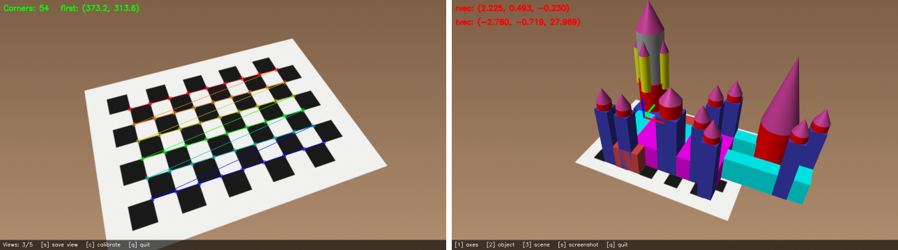
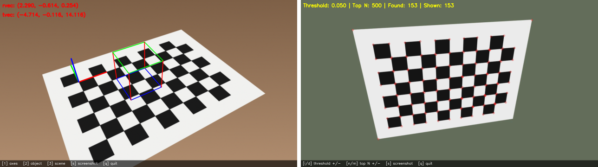
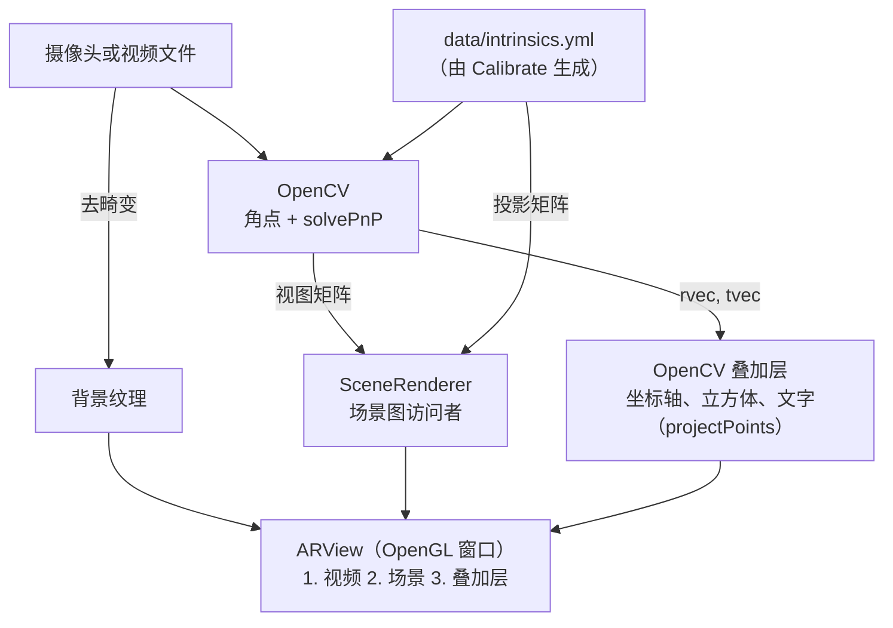

# SceneGraph AR

[English](README.md) | **简体中文**

一个用 C++、OpenCV 和 OpenGL 实现的相机标定与基于标记的增强现实（AR）项目。目标物是一张打印
出来的 9×6 棋盘格：OpenCV 用若干张视图标定相机，并在每一帧视频中估计棋盘的位姿；OpenGL 则用
由标定结果构造的投影矩阵，渲染一个带光照和深度测试、立在棋盘上的三维场景图（来自 SceneGraph
Renderer 的霍格沃茨城堡），使它与视频画面精确对齐。另外还有一个检测 Harris 角点的程序，用来
实验特征点。


*左：`Calibrate` 找到 54 个内角点并按顺序连线。右：`AugmentedReality` 用 OpenGL 渲染霍格沃茨
场景图，棋盘坐标轴和实时位姿由 OpenCV 绘制在最上层。两帧画面都来自测试用的合成棋盘格视频；
在程序中按 `S` 可以保存你自己的截图。*

**目录：** [亮点](#亮点) ·
[技术栈](#技术栈) ·
[架构](#架构) ·
[实现原理](#实现原理) ·
[项目结构](#项目结构) ·
[构建与运行](#构建与运行)

## 亮点

- **相机标定**：亚像素精度的棋盘格角点、由用户挑选的标定视图，用 `cv::calibrateCamera` 求出
  相机矩阵和五个畸变系数，结果写入 YAML 文件，供 AR 程序读取。
- **实时位姿估计**：每帧用 54 组角点对应关系调用 `cv::solvePnP`，旋转和平移实时显示在画面上。
- **虚拟物体**：棋盘原点上的三维坐标轴，以及悬浮在棋盘上方的多色线框立方体，都用
  `cv::projectPoints` 投影，可以按键开关。
- **OpenCV + OpenGL**：标定得到的内参被转换成 OpenGL 投影矩阵，`solvePnP` 的位姿被转换成视图
  矩阵，OpenGL 与 `projectPoints` 的投影结果相差不到 0.001 像素。视频先去畸变再作为背景纹理
  绘制，场景图带深度缓冲和 Blinn-Phong 光照渲染在其上，OpenCV 绘制的内容作为透明叠加层合成在
  最上方。
- **场景图渲染**：沿用 SceneGraph Renderer 的文本场景格式（网格、材质、变换、子树复制），加载
  成场景图后，每帧由带矩阵栈的访问者遍历绘制；每个网格只上传一次 GPU。
- **Harris 角点**：完整的检测流程（响应、相对最强响应的阈值、非极大值抑制、取前 N 个），阈值
  和 N 可以在视频运行时调整。
- **支持视频文件输入**：每个程序都接受摄像头编号或视频文件，没有摄像头也能复现结果。
- **跨平台构建**：CMake 预设加一键运行脚本。已在 Windows 11（Visual Studio 2026、OpenCV 4.13）
  和 Ubuntu 22.04（GCC 11、OpenCV 4.14，WSL2 环境）上验证。


*左：虚拟物体是一个 2×2×2 的立方体，悬浮在棋盘上方一格处，同时显示棋盘坐标轴（X 红、Y 绿、
Z 蓝）。右：`HarrisFeatures` 使用默认阈值（最强响应的 5%），检测到的每个点都是棋盘或纸张的
角点。合成测试画面。*

## 技术栈

| 方面 | 技术 |
|---|---|
| 语言 | C++17（只用 STL，没有使用游戏引擎） |
| 计算机视觉 | [OpenCV](https://opencv.org/) 4：`calib3d`（标定、PnP、投影、去畸变）、`imgproc`、`videoio`、`highgui` |
| 图形 | OpenGL 3.3 core profile、GLSL 330（forward-compatible 上下文，因此也能在 macOS 上运行） |
| 窗口与输入 | [GLFW](https://www.glfw.org/) 3.4（AR 程序）；OpenCV HighGUI（标定和 Harris 程序） |
| 数学库 | [GLM](https://github.com/g-truc/glm) 1.0 |
| OpenGL 加载器 | [glad](https://glad.dav1d.de/)（生成的代码，随项目提供） |
| 构建 | CMake ≥ 3.21，使用 `CMakePresets.json`；GLFW 和 GLM 通过 `FetchContent` 获取（锁定版本） |
| 资源格式 | Wavefront OBJ 网格、自定义的文本场景格式、OpenCV YAML 格式的标定结果 |
| 平台 | Windows（Visual Studio + OpenCV 官方安装包）、Linux（GCC / Clang，X11 / Wayland）、macOS（Apple Clang + Homebrew；尚未在真机上验证） |

## 架构

项目构建三个程序。它们共用 OpenCV 部分的库 `sgar_common`；AR 程序还使用 OpenGL 部分的库
`sgar_render`。

| 程序 | 对应任务 | 功能 |
|---|---|---|
| [`Calibrate`](src/apps/Calibrate.cpp) | 1–3 | 检测棋盘、保存视图、标定，写出 `data/intrinsics.yml` |
| [`AugmentedReality`](src/apps/AugmentedReality.cpp) | 4–6、扩展 | 读取标定结果，估计棋盘位姿，绘制坐标轴和线框物体，用 OpenGL 渲染场景 |
| [`HarrisFeatures`](src/apps/HarrisFeatures.cpp) | 7 | 检测并绘制 Harris 角点，参数可调 |

任务编号对应课程作业的七个任务：1 检测目标角点、2 选取标定视图、3 标定相机、4 估计相机位姿、
5 投影三维坐标轴、6 绘制虚拟物体、7 检测稳健特征。



| 模块 | 职责 |
|---|---|
| [`Calibration`](src/Calibration.h) | 棋盘尺寸、三维世界坐标点、角点检测、`calibrateCamera` 的封装、内参的读写 |
| [`AppUtils`](src/AppUtils.h) | 打开摄像头或视频文件、工作目录、`data/` 文件夹、画面底部的帮助栏 |
| [`ARView`](src/ARView.h) | GLFW 窗口和 OpenGL 上下文、三层画面合成、键盘输入、截图 |
| [`SceneRenderer`](src/SceneRenderer.h) | 加载场景图、上传网格，按相机和位姿带光照绘制 |
| [`gl/`](src/gl) | `CameraMatrices`（OpenCV 标定和位姿 → OpenGL 矩阵）、`ShaderProgram`、`Mesh`、`Texture` |
| [`sgraph/`](src/sgraph) | 场景图节点、场景文件导入器，以及负责绘制的访问者 `GLScenegraphRenderer` |
| [`util/`](src/util) | 多边形网格、OBJ 导入器、材质 |

**`AugmentedReality` 的一帧**（[主循环](src/apps/AugmentedReality.cpp#L205)）：

1. 在原始画面中寻找棋盘内角点；找到后，`solvePnP` 给出棋盘相对相机的旋转 `rvec` 和平移
   `tvec`。
2. 对画面去畸变，并用 `projectPoints` 在一张透明图像上绘制已开启的二维叠加内容（立方体、
   坐标轴、位姿、帮助栏）。
3. [`ARView::render`](src/ARView.cpp#L156) 依次绘制作为背景纹理的视频、开启深度测试的场景图、
   以及 alpha 混合的叠加层，然后交换缓冲区。
4. 处理 GLFW 收集到的按键。

## 实现原理

### 目标物及其坐标系

棋盘有 9 × 6 个内角点。世界坐标以棋盘格的边长为单位，并且固定在棋盘上
（[`buildPointSet`](src/Calibration.cpp#L18)）：第 `row` 行第 `col` 列的角点对应三维点
`(col, -row, 0)`。X 沿第一行向右，Y 沿棋盘向上，Z = X × Y 垂直于棋盘指向相机，所以 Z > 0
的物体都悬浮在棋盘上方。每张视图都使用同一组 54 个点，因为动的是相机，世界坐标不变。

### 标定（任务 1–3）

- **角点**（[`detectCorners`](src/Calibration.cpp#L34)）：`findChessboardCorners` 开启自适应
  阈值、图像归一化和快速检查（没有棋盘的帧会被很快跳过），然后 `cornerSubPix` 在 11 × 11 的
  窗口内把每个角点细化到 0.001 像素。返回的角点按行优先排列，通常从左上角开始，与世界坐标点
  的顺序一致。窗口中会显示角点数量和第一个角点的位置，角点顺序翻转时一眼就能看出来。
- **视图**：按 `S` 保存最近一次成功检测到的角点和对应的世界坐标点，并把画有角点的画面保存为
  `data/calib_NNN.png`。没有检测到棋盘的帧不会被保存。
- **求解**（[`runCalibration`](src/Calibration.cpp#L65)）：保存了至少 5 张视图后，按 `C`
  调用 `cv::calibrateCamera`，初始值为

  ```
        [ 1  0  w/2 ]
  K0 =  [ 0  1  h/2 ]
        [ 0  0   1  ]
  ```

  求出焦距、主点和畸变系数（k1、k2、p1、p2、k3）。程序会打印标定前后的相机矩阵和畸变系数，
  以及重投影误差，误差小于 1 像素说明标定效果良好。结果连同图像尺寸和误差一起写入
  `data/intrinsics.yml`。

### 位姿与投影（任务 4–6）

- **位姿**：`solvePnP` 求出把棋盘世界坐标点映射到检测角点的旋转和平移。`tvec` 是棋盘原点在
  相机坐标系中的位置，单位是格，因此它的 Z 分量就是到棋盘的距离；相机向右移动时 X 分量会变小。
  `rvec` 是以 Rodrigues 向量表示的旋转。
- **坐标轴**（[`drawAxes`](src/apps/AugmentedReality.cpp#L82)）：用 `projectPoints` 投影原点
  以及长 2 格的 X、Y、Z 轴端点。
- **虚拟物体**（[`drawVirtualObject`](src/apps/AugmentedReality.cpp#L98)）：立方体位于
  Z = 1 到 3 之间，它的 8 个顶点用 `projectPoints`（旋转、平移、相机矩阵和畸变）投影到图像上，
  12 条棱用三种颜色绘制。

### 用 OpenGL 渲染场景（扩展）

**与相机保持一致。** 去畸变后的视频和 OpenGL 必须使用同一个针孔相机模型。
[`projectionFromIntrinsics`](src/gl/CameraMatrices.cpp#L15) 把 K 和图像尺寸 w × h 转换成
OpenGL 投影矩阵，其中 n、f 是近、远裁剪面：

```
      [ 2fx/w    0       1 - 2(cx+0.5)/w      0         ]
P  =  [ 0        2fy/h   2(cy+0.5)/h - 1      0         ]
      [ 0        0       -(f+n)/(f-n)         -2fn/(f-n) ]
      [ 0        0       -1                   0         ]
```

[`viewFromPose`](src/gl/CameraMatrices.cpp#L42) 由 `rvec` 和 `tvec` 构造 `[R | t]`，并把其中的
Y、Z 两行取反：OpenCV 的相机朝 +Z 看、Y 轴沿图像向下，而 OpenGL 的相机朝 -Z 看、Y 轴向上。
+0.5 项对应 OpenCV 把像素中心放在整数坐标上的约定。经过 P · V 渲染的点，与 `projectPoints`
算出的位置相差不到 0.001 像素。

**畸变。** OpenGL 只能做针孔投影，所以用同一个 K 通过 `initUndistortRectifyMap` / `remap`
（映射表只计算一次）对画面去畸变。位姿仍然用原始角点加畸变系数来估计，叠加层则按无畸变投影，
这样三层画面完全对齐。

**三层画面**（[`ARView::render`](src/ARView.cpp#L156)），绘制在一个与视频宽高比相同的视口中：

1. 去畸变后的画面，每帧上传到纹理，作为铺满视口的四边形绘制，不写入深度。
2. 场景图，开启深度测试。
3. OpenCV 叠加层：一张初始为全透明的 RGBA 图像，坐标轴、立方体和文字以抗锯齿方式画在上面。
   在透明图像上抗锯齿绘制得到的正好是预乘 alpha，因此用
   `glBlendFunc(GL_ONE, GL_ONE_MINUS_SRC_ALPHA)` 混合。

**场景图。** 模型是用 SceneGraph Renderer 的场景语言描述的霍格沃茨城堡
（[`hogwarts.txt`](assets/scenegraphmodels/hogwarts.txt)）：17 个使用长方体、圆柱、圆锥网格的
叶子节点、20 次子树复制，以及平移和缩放节点。

```
instance cylinder models/cylinder.obj

material tower-body-mat
ambient 1 0 0
end-material

translate translate-tower-1 translate-tower-1 5 25 -5
add-child translate-tower-1 root
...
leaf body-1 body-1 instanceof cylinder
assign-material body-1 tower-body-mat
copy tower-2 tower-1                  # 深拷贝整棵子树
```

- **加载**（[`SceneRenderer::load`](src/SceneRenderer.cpp#L28)）：
  [`ScenegraphImporter`](src/sgraph/ScenegraphImporter.h#L54) 构建场景图，每个 OBJ 网格（位置
  和法线）只上传一次，存入顶点数组对象（VAO）。
- **绘制**（[`SceneRenderer::draw`](src/SceneRenderer.cpp#L54)）：访问者
  [`GLScenegraphRenderer`](src/sgraph/GLScenegraphRenderer.h#L57) 带着矩阵栈遍历场景图，矩阵栈
  的初始值是 `V · M`，其中摆放变换（[`scenePlacement`](src/apps/AugmentedReality.cpp#L53)）

  ```
  M = scale(0.1) · translate(0, -60, 0) · rotateX(90°)
  ```

  把模型立起来（模型的 Y 轴变成棋盘的 Z 轴）、移到棋盘上，并让 10 个场景单位等于一格。每个
  叶子节点用当前的 modelview 矩阵、对应的法线矩阵和材质颜色绘制自己的网格：每帧约 16,600 个
  三角形。在测试电脑上，一帧 1280 × 720 的完整画面（两次纹理上传、城堡和叠加层）大约需要
  1.7 毫秒。
- **光照**（[`scene.frag`](assets/shaders/scene.frag)）：Blinn-Phong 模型，使用一盏固定在棋盘
  上的平行光（来自上方、前方偏左），所以相机绕着棋盘移动时，明暗关系保持一致。

### Harris 角点（任务 7）

[`detectAndDrawHarris`](src/apps/HarrisFeatures.cpp#L54) 按照教材中的流程实现：

```
A = Σ_window [ Ix²   IxIy ]        H = det(A) - k · trace(A)²,  k = 0.04
             [ IxIy  Iy²  ]
```

1. `cornerHarris` 用 2 × 2 的窗口和 3 × 3 的 Sobel 梯度计算 H。H 在角点处是很大的正数，在边缘
   处为负，在平坦区域接近 0。
2. 去掉 H 低于"阈值 × 最强响应"（默认阈值 0.05）的像素。阈值直接作用在原始 H 上：如果先把 H
   缩放到 [0, 255]，最负的边缘响应会被映射成 0，平坦区域反而会通过阈值。
3. 非极大值抑制只保留等于自身 3 × 3 邻域最大值（即 `dilate` 后的响应）的像素，使每个角点只
   对应一个点。
4. 候选点按 H 排序，绘制最强的 N 个（默认 500）。

在棋盘上，响应最强的就是内角点。这也说明了这类角点特征为什么可以代替棋盘作为 AR 的目标：
只要能在每一帧中找到并匹配同一批点，它们已知的三维位置就能通过 `solvePnP` 求出位姿。

## 项目结构

```
.
├── CMakeLists.txt            三个程序、OpenCV 和 OpenGL 两个库、资源和 DLL 复制
├── CMakePresets.json         预设：msvc（Windows）、default（macOS / Linux）
├── run.bat                   一键构建并运行（Windows）
├── run.sh / run.command      一键构建并运行（macOS / Linux；.command 用于在 Finder 中双击）
├── cmake/
│   └── Dependencies.cmake    查找 OpenCV，GLFW 和 GLM 的版本，glad
├── src/
│   ├── apps/
│   │   ├── Calibrate.cpp         任务 1–3
│   │   ├── AugmentedReality.cpp  任务 4–6 和 OpenGL 场景图扩展
│   │   └── HarrisFeatures.cpp    任务 7
│   ├── Calibration.*         棋盘定义、角点、标定、内参文件
│   ├── AppUtils.*            视频输入、工作目录、data 文件夹、帮助栏
│   ├── ARView.*              OpenGL 窗口：视频、场景和叠加层
│   ├── SceneRenderer.*       场景图的加载与带光照的绘制
│   ├── VertexAttrib.h        顶点布局：位置、法线
│   ├── gl/                   CameraMatrices, ShaderProgram, Mesh, Texture
│   ├── sgraph/               场景图
│   │   ├── SGNode, AbstractSGNode, ParentSGNode, GroupNode, LeafNode
│   │   ├── TransformNode, TranslateTransform, RotateTransform, ScaleTransform
│   │   ├── SGNodeVisitor, GLScenegraphRenderer（OpenGL 绘制访问者）
│   │   └── IScenegraph, Scenegraph, ScenegraphImporter
│   └── util/                 PolygonMesh, ObjImporter, Material, IVertexData
├── third_party/
│   └── glad/                 生成的 OpenGL 加载器
├── assets/                   构建时复制到可执行文件旁边
│   ├── scenegraphmodels/     hogwarts.txt
│   ├── models/               OBJ 网格：box、cone、cylinder
│   └── shaders/              image.*（视频和叠加层）、scene.*（带光照的网格）
└── docs/
    └── images/               README 配图
```

## 构建与运行

### 快速开始

一个脚本就能完成配置、编译和启动程序，不需要手动执行任何 CMake 命令。只要装好了
[环境要求](#环境要求)里列出的工具即可。

| | |
|---|---|
| Windows | 双击 `run.bat`，或在终端里运行 `run.bat [程序] [输入源]` |
| macOS | 在 Finder 里双击 `run.command`，或在终端里运行 `./run.sh [程序] [输入源]` |
| Linux | `./run.sh [程序] [输入源]` |

- `程序` 可以是 `calibrate`、`ar` 或 `features`。不指定时，还没有保存过标定结果就启动
  `calibrate`，之后启动 `ar`。
- `输入源` 是摄像头编号（默认 `0`）或视频文件，例如 `run.bat ar my-video.mp4` 或
  `./run.sh features 1`。

第一次使用的典型流程：运行脚本，从 5 到 10 个不同角度展示棋盘并分别按 `S`，按 `C` 完成标定，
再按 `Q` 退出。之后再次运行脚本就会启动 AR 程序。

第一次运行时还会下载 GLFW 和 GLM，因此需要联网，耗时也会长一些。在 macOS 和 Linux 上，请用
`git clone` 获取项目，不要直接从 Windows 拷贝文件夹，这样 shell 脚本才能保持 Unix 换行符；
如果 `./run.sh` 提示 "Permission denied"，先运行一次 `chmod +x run.sh run.command`。

### 环境要求

脚本没法替你安装编译器和 OpenCV，所以需要先装好以下工具（只需一次）：

| | Windows | macOS | Linux |
|---|---|---|---|
| 编译器 | Visual Studio 2019 或更新版本，并安装"使用 C++ 的桌面开发"工作负载 | Xcode 命令行工具（`xcode-select --install`） | 支持 C++17 的 `g++` 或 `clang++` |
| 构建工具 | CMake ≥ 3.21、Git | CMake ≥ 3.21（`brew install cmake`）；Git 随命令行工具一起安装 | CMake ≥ 3.21、`make`、`pkg-config`、Git |
| OpenCV | 官方 Windows 安装包，见下文 | `brew install opencv` | 发行版的软件包，例如 `libopencv-dev` |
| 其他开发库 | – | – | X11 和 Wayland 开发包（GLFW 会从源码编译） |
| 图形 | OpenGL 3.3 | OpenGL 3.3 core（macOS 自带） | OpenGL 3.3（Mesa 或显卡厂商驱动） |

**Windows**：从 [opencv.org/releases](https://opencv.org/releases/) 下载 Windows 安装包，运行后
把 OpenCV 解压到某个目录，例如 `C:\opencv`。CMake 需要能找到 `C:\opencv\build`，以下任意一种
方式都可以：

- 解压到 `C:\opencv`（或者用 `choco install opencv` 安装，它会装到 `C:\tools\opencv`）；
- 把环境变量 `OpenCV_DIR` 设为 `C:\opencv\build`；
- 按 OpenCV 文档的建议，把 `C:\opencv\build\x64\vc16\bin` 加入 `PATH`。

构建时会把 OpenCV 的 DLL（包括读取视频文件用的 FFmpeg 插件）复制到可执行文件旁边，所以运行时
不需要修改 `PATH`。

**Debian / Ubuntu**：

```bash
sudo apt install build-essential cmake git pkg-config libopencv-dev libx11-dev libxrandr-dev libxinerama-dev libxcursor-dev libxi-dev libwayland-dev libxkbcommon-dev
```

其他发行版需要同样的库，具体包名见 GLFW 的[编译指南](https://www.glfw.org/docs/3.4/compile.html)。

**macOS**：第一次运行时系统会询问是否允许终端使用摄像头，请选择允许（系统设置 → 隐私与安全性
→ 摄像头）。

### 手动构建（可选）

只有在你想自己运行 CMake 或在 IDE 里构建时才需要。在项目根目录执行：

**Windows**

```bash
cmake --preset msvc
cmake --build --preset msvc
```

**macOS / Linux**

```bash
cmake --preset default
cmake --build --preset default
```

可执行文件和一份 `assets/` 副本会生成在 `build/bin/` 中。想从头重新构建，删掉 `build/` 文件夹
即可（保存的标定结果也会一起删除）。

> Visual Studio 可以直接打开项目文件夹，它会读取 `CMakePresets.json`。VS Code 中安装
> **CMake Tools** 扩展后，选择 `msvc` 或 `default` 预设即可。

### 运行

脚本会自动启动程序。如果要直接运行编译好的程序：

```bash
./build/bin/Calibrate [摄像头编号 | 视频文件]
./build/bin/AugmentedReality [摄像头编号 | 视频文件]
./build/bin/HarrisFeatures [摄像头编号 | 视频文件]
```

可以从任意目录启动。程序写出的所有文件都在 `build/bin/data/` 中：

| 文件 | 由谁写出 |
|---|---|
| `intrinsics.yml` | `Calibrate`（按 `C`）；由 `AugmentedReality` 读取 |
| `calib_NNN.png` | `Calibrate`（按 `S`）：保存的标定视图，画有角点 |
| `ar_NNN.png` | `AugmentedReality`（按 `S`）：渲染结果，不含帮助栏 |
| `harris_thresh<T>_top<N>_NNN.png` | `HarrisFeatures`（按 `S`），文件名中带有当前参数 |

标定结果只对应一种分辨率；如果摄像头输出的分辨率不同，`AugmentedReality` 会打印警告，此时应
重新标定。

### 操作按键

| 程序 | 按键 | 作用 |
|---|---|---|
| `Calibrate` | `S` | 保存当前视图（只在检测到棋盘时有效） |
| | `C` | 用已保存的视图（至少 5 张）标定，并写出 `intrinsics.yml` |
| `AugmentedReality` | `1` / `2` / `3` | 开关坐标轴 / 线框物体 / 场景 |
| | `S` | 保存截图 |
| `HarrisFeatures` | `I` / `D` | 阈值增大 / 减小 0.01 |
| | `N` / `M` | N 增大 / 减小 100 |
| | `S` | 保存截图 |
| 所有程序 | `Q` 或 `Esc` | 退出（关闭窗口也会退出 `AugmentedReality`） |

### 依赖

所有依赖都在 [cmake/Dependencies.cmake](cmake/Dependencies.cmake) 中声明：

| 库 | 版本 | 提供方式 |
|---|---|---|
| [OpenCV](https://opencv.org/) | 4.x（已在 4.13 和 4.14 上验证） | 安装在系统中，通过 `find_package` 查找 |
| [GLFW](https://www.glfw.org/) | 3.4 | `FetchContent`，从源码编译 |
| [GLM](https://github.com/g-truc/glm) | 1.0.0 | `FetchContent`，仅头文件 |
| [glad](https://glad.dav1d.de/) | GL 4.0 core | 放在 `third_party/glad` 中 |

要升级 GLFW 或 GLM，修改 `Dependencies.cmake` 里对应的 `GIT_TAG`，然后重新配置即可。

### 代码规范

- 格式由 [.clang-format](.clang-format)（Allman 风格大括号、4 空格缩进、每行 100 列）和
  [.editorconfig](.editorconfig)（UTF-8、LF 换行符）定义。
- 构建开启 `/W4`（MSVC）和 `-Wall -Wextra`（GCC、Clang），编译没有任何警告。
- 命名：类型用 `PascalCase`，函数用 `camelCase`，常量用 `UPPER_CASE`；项目自己的代码中变量用
  `snake_case`（与 OpenCV 标定相关的术语保持一致：`corner_set`、`point_list`、`camera_matrix`），
  类成员以 `_` 结尾。场景图相关的类沿用其来源课程框架的 `camelCase` 命名。

## 致谢

- **Na Yin**：相机标定（任务 1–3：[`Calibration`](src/Calibration.h) 和
  [`Calibrate`](src/apps/Calibrate.cpp)）。
- **Yu Cao**：位姿估计与增强现实（任务 4–6）、Harris 特征（任务 7），以及场景图扩展和它的
  OpenGL 渲染。
- `src/sgraph/` 中的场景图类（`GLScenegraphRenderer` 除外）和 `src/util/` 改编自 Amit Shesh
  的课程场景图框架。
